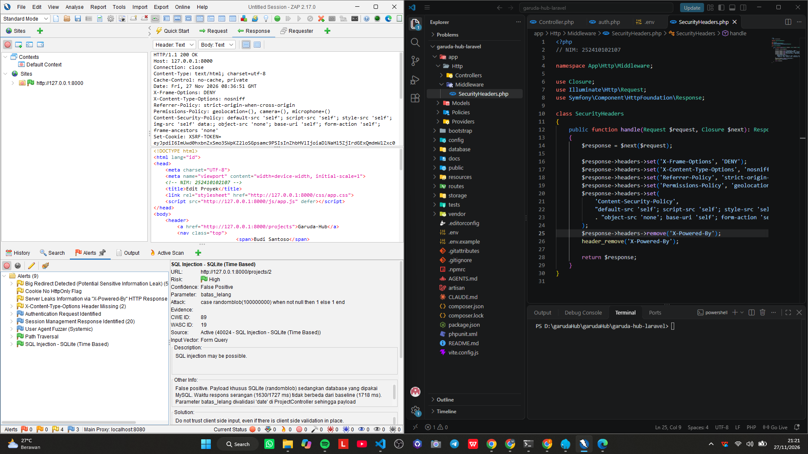

# Garuda-Hub (Laravel) — Episode 2: Secure the System

**Nama:** MIRZA UCHMAL GANI
**NIM:** 252410102107
**Branch:** `ep2-security`

## Hasil Scan OWASP ZAP



Hasil: **0 High, 0 Medium, 4 Low, 3 Informational**. Komentar NIM terlihat di
`app/Http/Middleware/SecurityHeaders.php` (`// NIM: 252410102107`) dan di HTML
layout (`<!-- NIM: 252410102107 -->`).

Laporan lengkap: [docs/zap-report.html](docs/zap-report.html)

## Perbaikan Keamanan

| Misi | Implementasi | File |
| --- | --- | --- |
| Login/Logout + hashing kuat | `Auth::attempt`, password bcrypt (cast `hashed`, cost 12) | `AuthController.php`, `User.php` |
| Session | `session()->regenerate()` saat login, `invalidate()` + `regenerateToken()` saat logout, cookie HttpOnly + SameSite=Lax, lifetime 30 menit | `AuthController.php`, `.env` |
| CSRF | `@csrf` di semua form, logout lewat POST | `resources/views/**` |
| XSS (output encoding) | Seluruh output memakai `{{ }}`, tidak ada `{!! !!}` | `resources/views/**` |
| CSP & header keamanan | CSP `script-src 'self'`, X-Frame-Options, nosniff, Referrer-Policy; CSS/JS inline dipindah ke `public/` | `SecurityHeaders.php`, `public/css`, `public/js` |
| Otorisasi | Hanya pemilik proyek (atau admin) yang boleh edit/hapus; `client_id` diambil dari sesi | `ProjectPolicy.php`, `ProjectController.php` |
| Brute force | `throttle:5,1` pada login | `routes/web.php` |
| Validasi input | Aturan `integer`, `date`, `in:`, `max:` | `ProjectController.php` |

SQL Injection dicegah dengan Eloquent/Query Builder (parameter ter-bind). Tidak ada
query mentah (`DB::raw`/`whereRaw`) di aplikasi.

## Catatan False Positive

Dua alert High dari scan aktif sudah diverifikasi sebagai false positive dan ditandai di ZAP:

1. **Path Traversal** pada `budget_min`: evidence kosong, confidence Low, input divalidasi
   `integer` dan tidak dipakai untuk akses file. Response 200 berisi halaman biasa tanpa
   isi file sistem.
2. **SQL Injection (SQLite, time based)** pada `batas_lelang`: payload khusus SQLite
   sedangkan database yang dipakai MySQL. Waktu respons serangan (1630/1727 ms) tidak
   berbeda dari baseline (1718 ms), dan input ditolak validasi `date` sebelum mencapai query.

Alert Low yang tersisa (X-Powered-By dari PHP dev server, cookie XSRF-TOKEN tanpa HttpOnly
bawaan Laravel, dan lainnya) tidak memengaruhi syarat bebas High/Critical.

## Menjalankan Secara Lokal

```bash
composer install
cp .env.example .env
php artisan key:generate
# isi koneksi MySQL di .env, lalu:
php artisan migrate --seed
php artisan serve
```

Akun seeder berdomain `example.com`. Atur password sendiri lewat `php artisan tinker`.